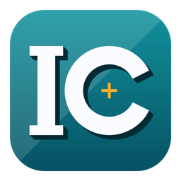
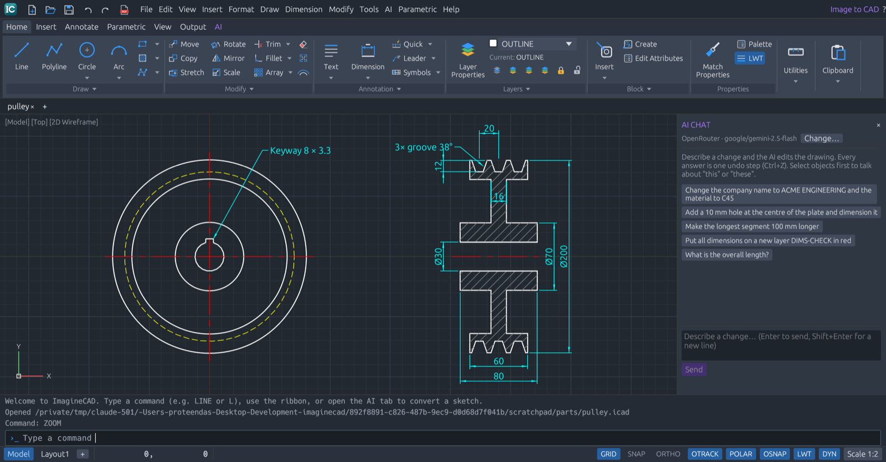
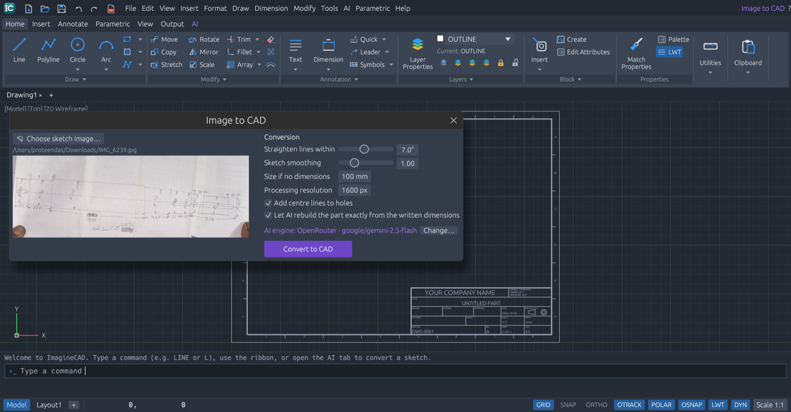
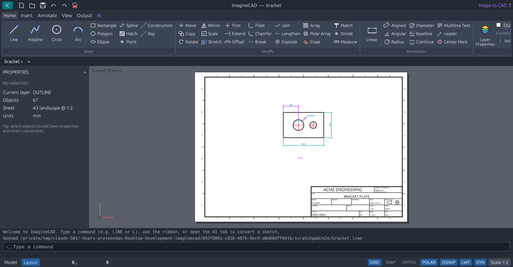
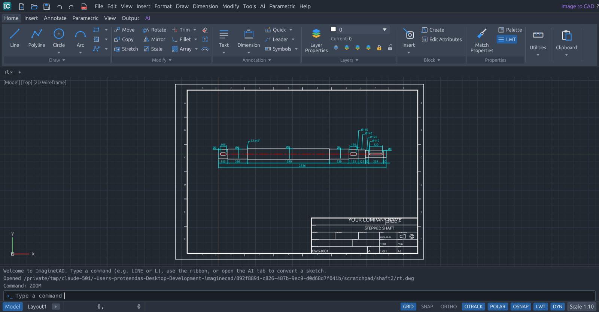
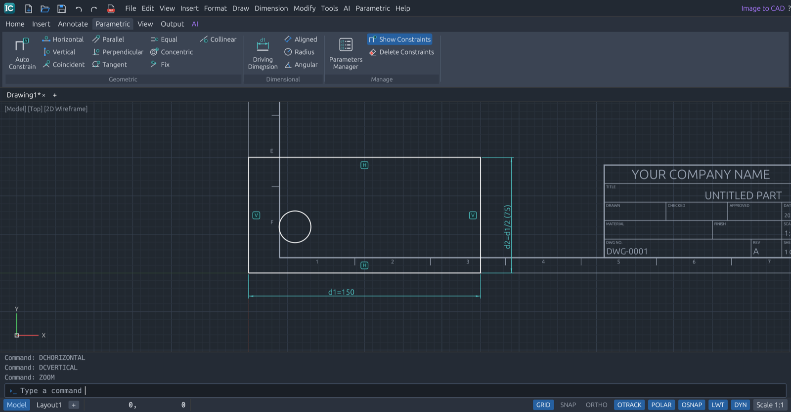
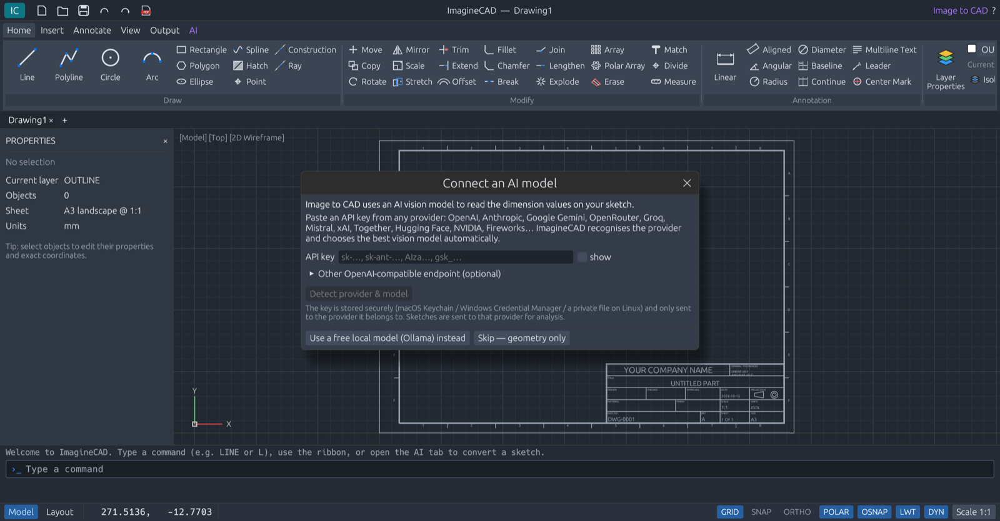

<p align="center">
  
</p>

<h1 align="center">ImagineCAD</h1>

<p align="center">
  <b>Professional 2D CAD for mechanical drawings, with AI sketch-to-CAD.</b><br>
  Opens and saves DWG and DXF · photograph a hand sketch, get a dimension-exact drawing<br>
  Built in Rust · macOS · Windows · Linux · GPL-3.0 open source, commercial licenses available
</p>

<p align="center">
  
  
  
  
  
  <br>
  
  
  
  
  
  
  
</p>

> [!WARNING]
> **Early alpha access.** ImagineCAD is still under active development. Features,
> commands, file formats and the user interface may change between releases, and
> you may run into bugs or missing pieces. Keep backups of important drawings
> (DWG/DXF exports are a good safety net), and please report problems or ideas
> through the repository's issues.

---



## Highlights

- **Parametric drafting.** Geometric constraints (parallel, tangent, coincident…) and named driving dimensions with expressions (`d2 = d1 / 2`) keep a design's relationships true as you edit.
- **Industry-standard drafting workflow.** Ribbon that fits any window, a menu bar with every command, command line with aliases and autocomplete, object snaps, polar tracking, ortho, grips, layers, a properties palette, blocks, hatching, dimensions and leaders, model and paper layouts.
- **Open, edit and save DWG and DXF.** DWG 2000–2018 drawings are read by ImagineCAD's own DWG reader, written in Rust; saving DWG uses GNU LibreDWG, which ships inside the installer (the free ODA File Converter is used automatically when installed). DXF 2000 is written natively with full fidelity, or R12 for maximum compatibility.
- **Image to CAD.** Upload a photo of a hand-drawn mechanical sketch. An AI model reads the handwritten dimensions and describes the part (shafts with threads and surface finish, rings, flanges, pulleys, gears, springs, plates, any profile, or several parts with a parts list); the description is validated against the written values and its own geometry before it is drawn. Otherwise computer vision traces the sketch and a solver makes every dimension exact, including slanted lengths, angles and fillet radii, across aligned views. You get an editable drawing with a title block, with the sketch overlaid for review.
- **Scripts, plugins and languages.** Automate with command scripts, add commands with plugins in any language, and use the interface in English, German, French, Spanish, Italian or Portuguese.
- **AI Chat.** Describe a change ("make the long segment 1400 mm", "set the material to C45") and the AI edits the drawing; each answer is one undo step, and manual editing stays available.
- **Any AI provider.** Paste any API key (OpenAI, Anthropic, Google Gemini, OpenRouter, Groq, Mistral, xAI, Together, Hugging Face, NVIDIA, Fireworks…). ImagineCAD recognises the provider and configures the best vision model automatically. Prefer free and private? Use a local Ollama model, or no AI at all.
- **Title block and true-scale plotting.** ISO-style title block with your company name in the bottom-right corner; PDF (or archival PDF/A) and SVG output at true scale with lineweights and an optional plot stamp; section and detail views generated from the geometry.

| Hand sketch (not to scale) | Converted, dimension-exact drawing |
|---|---|
|  |  |

| A DWG file opened for editing | Parametric drafting |
|---|---|
|  |  |

## Feature overview

| Area | Commands |
|---|---|
| Draw | `LINE` `PLINE` `CIRCLE` `ARC` `RECTANG` `POLYGON` `ELLIPSE` `SPLINE` `POINT` `XLINE` `RAY` `HATCH` |
| Modify | `MOVE` `COPY` `ROTATE` `SCALE` `MIRROR` `STRETCH` `OFFSET` `TRIM` `EXTEND` `FILLET` `CHAMFER` `BREAK` `BREAKATPOINT` `JOIN` `LENGTHEN` `ARRAYRECT` `ARRAYPOLAR` `EXPLODE` `ERASE` `OOPS` `MATCHPROP` `DIVIDE` `MEASURE` `OVERKILL` |
| Annotate | `TEXT` `MTEXT` `TEXTEDIT` `LEADER` `MLEADER` `DIMLINEAR` `DIMALIGNED` `DIMANGULAR` `DIMRADIUS` `DIMDIAMETER` `DIMORDINATE` `DIMARC` `QDIM` `DIMBASELINE` `DIMCONTINUE` `DIMARRANGE` `CENTERMARK` `DIMSTYLE` `TOLERANCE` `DATUM` `SURFFINISH` `WELD` `TABLE` `STYLE` `SPELL` |
| Markup & views | `REVCLOUD`, `BOM` (bill of materials), `BALLOON`, `SECTIONVIEW`, `DETAILVIEW` |
| Parametric | `GCHORIZONTAL` `GCVERTICAL` `GCPARALLEL` `GCPERPENDICULAR` `GCCOLLINEAR` `GCEQUAL` `GCCOINCIDENT` `GCCONCENTRIC` `GCTANGENT` `GCFIX` `AUTOCONSTRAIN`, driving dimensions `DCHORIZONTAL` `DCVERTICAL` `DCALIGNED` `DCRADIUS` `DCDIAMETER` `DCANGULAR`, `PARAMETERS` |
| Blocks & references | `BLOCK` `INSERT` Blocks palette, dynamic blocks (`BEDIT` `BSTRETCH` `BFLIP` `BROTATE` `BARRAY` `BVSTATE` `BLOOKUP`), `IMAGEATTACH` raster underlays, `PURGE` |
| Layers | Layer Properties Manager, `LAYISO` `LAYUNISO` `LAYOFF` `LAYON` `LAYLCK` `LAYULK` `LAYMCUR` |
| Inquiry & selection | `DIST` `AREA` `ID` `LIST` `QSELECT` `SELECTALL` |
| Precision | typed coordinates (`x,y`, `@dx,dy`, `@d<a`), direct distance, object snaps (end, mid, center, quadrant, intersection, perpendicular, insertion, node, nearest), polar tracking, ortho, grid snap, dynamic input |
| Sheets & output | paper sizes A4–A0/ANSI, ISO scales, title block, layouts and viewports (`LAYOUTNEW` `MVIEW`), plot styles, `PLOT` to PDF or PDF/A, `PLOTSTAMP`, `PUBLISH`, sheet sets (`SHEETSET`), export DWG/DXF/SVG, `UNITS` |
| Automation & languages | `SCRIPT`, `imaginecad script`, plugins (`PLUGINS`), `LANGUAGE` (English, Deutsch, Français, Español) |
| AI | `IMAGETOCAD`, `AICHAT` (edit by conversation), `AISETUP` (any API key), `AISETTINGS`, headless `imaginecad convert` and `imaginecad ask` |

See the [User Guide](docs/USER_GUIDE.md) for every command and option.

## Install

Download the installer for your platform from the repository's **Releases** page:

| Platform | File |
|---|---|
| macOS 11+ (Apple silicon & Intel) | `ImagineCAD-x.y.z-macos-universal.dmg` — open it and drag ImagineCAD to Applications |
| Windows 10/11 x64 | `ImagineCAD-x.y.z-windows-x64-setup.exe` (or the portable `.zip`) |
| Linux x86_64 | `imaginecad_x.y.z_amd64.deb` (`sudo apt install ./imaginecad_*.deb`) or the portable `.tar.gz` |

DWG support is included in all installers; nothing else is required.

### Connect AI (for Image to CAD)

The first time you use **Image to CAD**, ImagineCAD asks for an API key:

1. Paste a key from any AI provider and click **Detect provider & model**.
2. ImagineCAD identifies the provider, verifies the key and picks the best vision model. You can change the model if you want.
3. **Save & continue.** The key is stored in the macOS Keychain, Windows Credential Manager, or a private file on Linux.

Prefer free and offline? Choose **Use a free local model (Ollama)** (`ollama pull qwen2.5vl:7b`), or **Skip** for geometry-only conversion. Details: [docs/AI_SKETCH_TO_CAD.md](docs/AI_SKETCH_TO_CAD.md).



## Quick start

1. **AI → Image to CAD** (`Ctrl+I`), or drop a sketch photo on the window.
2. **Convert to CAD**, then **Open as new drawing**. Check anything on the magenta `AI-REVIEW` layer.
3. **Annotate → Title Block**: company, title, drawing number, people, material…
4. **Output → DWG / DXF / PDF**, or simply **Save** a DWG you opened.

From a terminal:

```bash
imaginecad convert sketch.jpg -o part.dwg --api-key "$MY_KEY" --company "ACME ENGINEERING"
imaginecad convert sketch.jpg -o part.pdf --no-ai          # geometry only
imaginecad export drawing.dwg -o drawing.pdf
```

## Build from source

```bash
git clone <this repository> && cd imaginecad
cargo run --release -p imaginecad
cargo test --workspace
```

Rust 1.81+. See [docs/BUILDING.md](docs/BUILDING.md) for platform prerequisites, bundling LibreDWG, and building installers. [docs/RELEASING.md](docs/RELEASING.md) explains how GitHub Actions publishes the macOS, Windows and Linux installers to the Releases page.

## Documentation

| Document | Contents |
|---|---|
| [User Guide](docs/USER_GUIDE.md) | Interface, every command, input methods, layers, blocks, hatching, sheets, plotting, shortcuts |
| [Image to CAD](docs/AI_SKETCH_TO_CAD.md) | How sketch conversion works, API keys and providers, local models, tips |
| [File Formats](docs/FILE_FORMATS.md) | DWG, DXF 2000/R12, `.icad`, PDF, SVG |
| [Scripts and Plugins](docs/PLUGINS.md) | Command scripts, `imaginecad script`, writing plugins in any language |
| [Architecture](docs/ARCHITECTURE.md) | Crates, data model, rendering, command engine, vision pipeline |
| [Building](docs/BUILDING.md) | Toolchain, tests, LibreDWG, installers |
| [Releasing](docs/RELEASING.md) | Publishing installers with GitHub Actions, code signing |
| [Roadmap](docs/ROADMAP.md) | Status and planned features |
| [Contributing](CONTRIBUTING.md) | Workflow, CLA, code style |
| [Changelog](CHANGELOG.md) | Release history |

## License

ImagineCAD is © 2026 **Proteen Das** and is **dual-licensed**:

- **Open source:** [GNU General Public License v3.0](LICENSE) (`GPL-3.0-only`). Use, study, modify and share it. Distributed modifications must stay open under the GPL.
- **Commercial:** for proprietary products, OEM/re-branding, or warranty and support terms, see [COMMERCIAL-LICENSE.md](COMMERCIAL-LICENSE.md).

Contributions are accepted under the [Contributor License Agreement](CLA.md). The ImagineCAD name and logo are trademarks of Proteen Das ([TRADEMARKS.md](TRADEMARKS.md)). Third-party components are listed in `NOTICE` and in `THIRD_PARTY_LICENSES.html`, which ships with every installer.
